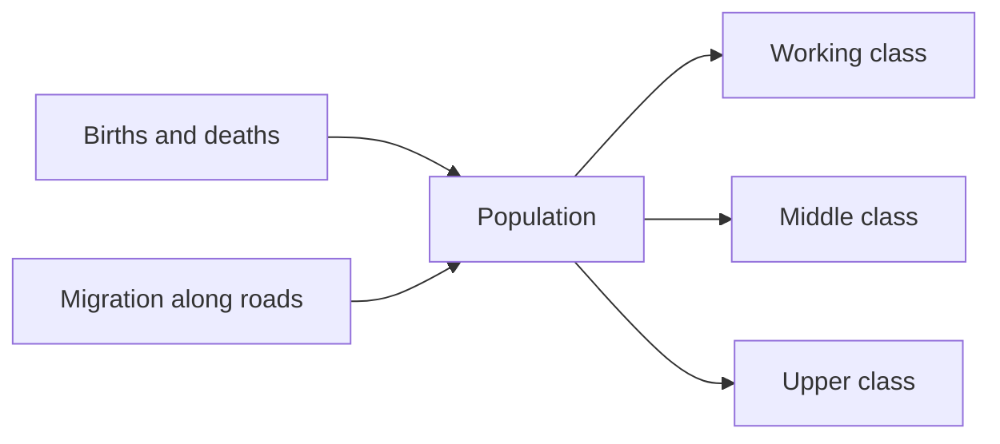
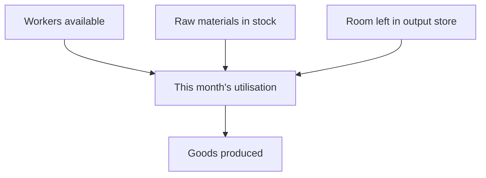
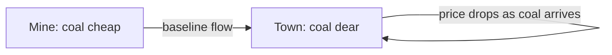

# How the island economy works

This is a plain explanation of what is happening under the hood of Ironway, written for players rather than programmers. If you want the exact formulas, see `DESIGN.md` section 7.

## The big idea

The island runs a real economy whether or not you touch anything. Settlements grow or shrink, mines and mills open or close, people take jobs or lose them, and goods move from where they are made to where they are wanted. In Phase 1 there is no transport company to play yet: you are watching the island live its own life so that when you do start a company in Phase 3, you are dropping a business into a world that was already breathing.

Everything updates once a month of game time. A game year is 360 days, so a month is 30 days exactly. Time can run at different speeds or be paused, but the economy itself does not know the difference: it always thinks in whole months.

## People and settlements

Every settlement (hamlet, village, town, city or the capital) has a population split into three classes: Working, Middle and Upper. Each class buys a different mix of goods and reacts differently to hard times, so a mining village and a merchant city feel different even on the same island.

People are born, die, and move. A settlement with spare housing and good prospects pulls people in from elsewhere; one with high unemployment, food shortages or no housing loses them. Over several years the class mix itself drifts to match what the local jobs actually need, so a settlement that grows a lot of factory jobs slowly becomes more of a Working class town.

## Making things: farms and industries

Farmland around every settlement produces grain, livestock, wool, milk and timber every month, with a seasonal rhythm (harvests peak in autumn, wool in spring). Industries, which are the mines, mills, works and foundries dotted around the island, turn raw materials into processed goods.

An industry's output each month depends on three things at once: whether it has enough workers, whether it has enough of its raw materials in stock, and whether its own warehouse still has room for more finished goods. If any one of those three is short, the whole month's output suffers, exactly like a real factory that cannot run flat out if the coal has not arrived.

## Wanting things: demand and prices

Every settlement wants goods every month: food and coal for everyone, and more clothing, manufactured goods and luxuries the richer the class. Industries want raw materials too, for their own production. All of that wanting adds up to one number per settlement per cargo, called demand.

Prices follow demand against the stock actually sitting in a settlement's warehouse. Plenty of stock against modest demand means a low price; a near-empty warehouse against strong demand means a high price, up to a ceiling. This is the signal that tells the island where goods are short, long before any mine or mill reacts to it.

## Moving things around

Goods do not teleport. A small, steady background trade moves stock along roads, rail and sea lanes between neighbouring places, following the price gradient: cargo drifts from where it is cheap (plentiful) towards where it is dear (scarce), a little further each month. This baseline trade is slow and capped low on purpose, it is what the island manages on its own, long before you ever run a train. Once you are operating services in Phase 3, your wagons and trains will move far more than this background trickle ever could, which is exactly the gap your transport company exists to fill.

## Jobs, wages and confidence

Each settlement's industries, farms, shops and building sites between them offer a certain number of jobs. People fill them up to the limit of who is available and willing; anyone left over is unemployed. Wages and the cost of living together decide how comfortable people feel, a figure called confidence. High confidence means people spend more freely and the settlement feels prosperous; low confidence means belts tighten, and if it stays low for long enough, people start to leave.

## Industries opening, growing and closing

An industry is not fixed in place forever. If a cargo is in sustained short supply and there is a plausible site nearby with the right raw materials, a brand new industry can open there, a scene you will see described in the game's events log. A busy, well-supplied industry can expand; a starved one first shrinks and then, if things never recover, closes outright and its workers join the unemployed pool. Mines and quarries also eventually use up what they are sited on and close for that reason alone, however well run they are. Later eras retire some older industry types in favour of newer ones, the way real industrial economies change over a century and a half.

## Trading with the rest of the world

Ports let the island trade with the outside world: importing what it cannot make enough of itself, exporting its surplus. How much can move through a port is capped by that port's own size, and ports that handle a lot of trade over time grow into bigger ones, able to handle more.

## The island's overall mood

Twice a year, in March and September, the game looks at the island as a whole, how is employment doing, is confidence rising or falling, is trade growing, and settles on one of five broad states: Depression, Recession, Normal, Boom or Peak. This island economy level moves at most one step at a time, never leaps straight from Depression to Boom, and it quietly nudges production and spending across the whole island up or down depending on where it sits. Once you are running a transport company, your own activity becomes one of the things that feeds into this score: a genuinely useful, profitable network nudges the island up over time, and an idle or loss-making one nudges it down.

## What this means for you, later

None of the above needs you to do anything, which is deliberate: it proves the island is alive before you ever spend a penny on it. When Phase 3 arrives and you start laying track and running services, you will be plugging a transport company into an economy that already has real shortages, real surpluses and real growth and decline happening on its own. Finding where the island's own slow background trade cannot keep up, and building something faster and bigger to close that gap profitably, is the heart of the game.
